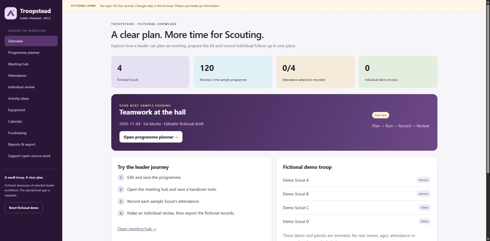

# Troopstead Demo

**A fictional workspace for exploring the work behind a Scout meeting.**

**v0.1.2 · 13 October 2026** — the first public fictional demo release.

Published by **Krēˈādiv Worx**. Copyright (c) 2026 **Raiden (blackstackdev)**. Original demo material is available under the [MIT licence](LICENSE).



## Try the leader journey

Plan a two-hour evening, run its meeting blocks, save a handover note, record fictional attendance, and make an individual observation before exporting the sample records. Try three original activity ideas, distinguish unknown stock from zero, prepare an event checklist, and compare entered budget estimates with actual amounts.

Every member label and example is invented. The sample fundraiser is a software demonstration, not a request for donations. No official advancement requirement or award is represented.

## Run locally

Use Node.js 22 or newer. Windows checks passed on Node 22.17.1 and 24.19.0. No dependency installation, account, API key or database is needed.

```sh
npm start
```

Open `http://127.0.0.1:4318/`. The included server binds to loopback only. If the port is already used, stop the other demo server first. Ctrl+C stops this server.

```sh
npm test
npm run check
```

Run through this server rather than double-clicking `index.html`: browser module and storage behaviour depend on the origin. No deployment is configured. GitHub CI runs the rule/server tests and limited package checker on Linux Node 24; inspect the [Actions history](https://github.com/blackstackdev/troopstead-demo/actions) for the result of each commit.

## Privacy and scope

**Use made-up information only.** Edits are stored in this browser under a dedicated demo key and may be included in your downloaded fictional JSON export. Reset clears this demo's local edits. Exported downloads remain on your computer after reset.

Troopstead is the project name. ScoutsApp is its separate private operational implementation. This demo was written independently; it is not a connected or anonymised copy of that app. It contains no operational source/history, live endpoints, youth records, credentials, official/group branding or third-party reference books.

There is no login, analytics, third-party script/font, payment flow or writable API. The static server serves only explicit demo assets and restricts network connections through CSP. Browser-local records and action logs are illustrative, editable and not a trusted operational audit ledger.

The release scope is exactly the 21 files listed in `docs/SCOPE.md`, including `LICENSE`. The downloadable release ZIP has a separate SHA-256 manifest and checksum. Owner-review documents and private audits are excluded. See `LICENSE-STATUS.md` for the licence boundary.

## Known limitations

- **Save before changing blocks or views.** Unsaved form text, including handover notes, can be lost when a view is rendered again.
- Meeting timer countdown restarts on view changes/reload; saved block position and saved notes persist.
- The sample programme has six blocks totalling 120 minutes. Selecting an activity changes block two's title; adjust its timing yourself if needed.
- Reviewed attendance cannot be changed to absent/excused through this demo; reset the fictional sample to start again.
- There is no operational import, account system, production concurrency protection, official-source planning, full reference library or real pilot outcome evidence.
- Windows Chrome and compact in-app browser checks are reported in `docs/VALIDATION.md`. Physical phones, printing, other operating systems and public hosting remain unverified. Hosted CI covers automated rules/server checks, not browser acceptance.

## Development support

Development support could fund maintainer time, tests, documentation, usability/accessibility investigation, issue review, release preparation and reviewed open-source hosting/tooling costs. No tiers, payment link, funding target, work hours, benefits or delivery commitments are set by this package. Troop equipment, camps and activities have a separate funding route.

Any cost shared between open-source development and a private app pilot must have an agreed allocation and must not be claimed twice. Real troop statistics also need a privacy review: small totals or combinations can identify a child. Use fictional public examples whenever that risk exists.

## Release scope

This release applies the approved MIT licence and updates licence/status wording in the interface and documentation. Planner, attendance, storage, timer and other workflow logic are unchanged from the reviewed v0.1.2 demo. Repository history starts fresh with this fictional package; no private operational history is imported. See `docs/CHANGELOG.md` and `docs/VALIDATION.md` for changes and tested scope.
